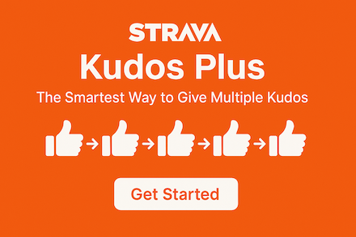

# Strava Kudos Plus

A Chrome extension that lets you give Kudos to eligible Strava activities with a single click.

**Current version: 1.30**

[Install from the Chrome Web Store](https://chromewebstore.google.com/detail/strava-kudos-plus/bpdnpccpbmdpdhfnnnfnokbaijbbcadm)

## Features

- Orange "Give X Kudos" button with a live count of eligible activities on the current page.
- Gradual distribution with randomized delays and longer pauses, rather than sending all Kudos at once.
- Excludes your own activities, activities already given Kudos, and group child entries that can trigger modals.
- Supports Strava dashboards, athlete pages, and club feeds.
- Recognizes both current and legacy Strava profile menus and retries detection while the page loads.
- Small, non-blocking Chrome Web Store review link below the button, visible only when eligible activities are available.
- No analytics, tracking, or additional permissions for feedback.

## Installation

### From Chrome Web Store
1. Visit [Strava Kudos Plus on the Chrome Web Store](https://chromewebstore.google.com/detail/strava-kudos-plus/bpdnpccpbmdpdhfnnnfnokbaijbbcadm)
2. Click "Add to Chrome"
3. Confirm the installation

## Usage

1. Sign in to Strava and open your dashboard, an athlete page, or a club feed.
2. Look for the "Give X Kudos" button near the top-left of the page. It appears only when your profile is detected and eligible activities are available.
3. Click once to start processing activities one by one. Keep the page open while it runs.
4. Scroll to load more activities as needed; the counter refreshes every second.

### Limits and stopping

- Strava may still throttle Kudos. Randomized delays do not guarantee avoiding its limits.
- The extension intentionally skips a small random share of activities, so the counter is not a guarantee of Kudos successfully delivered.
- There is no pause/resume button. Reload or leave the page to stop processing.
- Only activities present in the page are processed; the extension does not automatically scroll or fetch the entire feed.

### Share your feedback

When the "Give X Kudos" button is visible, a small invitation underneath links to the
Chrome Web Store. Click [**Leave a review on Chrome Web Store**](https://chromewebstore.google.com/detail/strava-kudos-plus/bpdnpccpbmdpdhfnnnfnokbaijbbcadm) to share your feedback
in a new tab, without starting Kudos. The invitation disappears along with the button
when no eligible activities remain. There are no popups, reminders, or review tracking.

## Building from Source

If you want to build the extension from source:

1. Clone this repository
2. Install dependencies with `npm install`
3. Run `npm run build` to create `chrome-extension/StravaKudos.zip`.
4. Open `chrome://extensions`, enable **Developer mode**, and select **Load unpacked**.
5. Select the `chrome-extension` folder, then reload Strava. Disable the Web Store copy while testing to avoid running both versions.

Run `npm test` after building to check profile detection and feedback behavior in both the source and the packaged script.

## Privacy Policy

This extension does not collect, store, or transmit any personal data from users.

**What this extension does:**
- The extension operates entirely within your browser
- It only interacts with the Strava website to identify and click kudos buttons
- It does not access, collect, or store any personal information
- It does not use cookies, analytics, or tracking technologies
- The extension does not send personal data to external servers.
- The feedback link opens the Chrome Web Store only when clicked; reviews are submitted there, not collected by the extension.

**Permissions:**
This extension requests host access to `https://www.strava.com/*`. Its content script runs on dashboard, athlete, and club pages to add the interface and click Kudos buttons. The feedback invitation adds no permissions.

See [PRIVACY.md](./PRIVACY.md) for the privacy policy.

## Contributing

Contributions are welcome! Feel free to submit a pull request or open an issue if you have ideas for improvements or have found a bug.

## License

This project is licensed under the MIT License - see the LICENSE file for details.

## Release Notes

### Version 1.30 - Feedback invitation

- Adds a small feedback invitation below the Kudos button, linking to the Chrome Web Store in a new tab.
- Shows the invitation only while eligible activities are available, without interrupting Kudos or requesting a particular rating.
- Adds no permissions, tracking, or changes to Kudos distribution.
- Refreshes installation, usage, limitations, and local testing documentation with the official store link.

### Version 1.29 - Strava profile menu compatibility

- Recognizes Strava's current profile menu as well as the previous layout.
- Retries profile detection as the page loads, so a delayed menu no longer leaves the button permanently hidden.
- Compares exact athlete IDs when excluding your own activities.

### Troubleshooting a missing button

The button and feedback invitation are only shown when your profile is detected and the page contains eligible activities from other athletes.
Version 1.28 depended on the old `.user-menu > a` profile link, which is no longer present
in the current dashboard. Reinstalling that version does not resolve the problem.

To test the current version locally, run `npm run build`, open `chrome://extensions`, enable Developer
mode, and use **Load unpacked** to select `chrome-extension` (or reload it if already loaded).
Disable the Web Store copy while testing to avoid running both versions, then reload Strava.
The Web Store copy will receive the fix only after the new package is published.

ℹ️ **Version 0.22 - Visual & UX Improvements**

•⁠  ⁠Completely redesigned the Kudos button with a modern, eye-catching UI
•⁠  ⁠Added a smooth color gradient using Strava's official orange color scheme
•⁠  ⁠Implemented hover and click animations for better visual feedback
•⁠  ⁠Added a heart icon for better visual representation of the Kudos action
•⁠  ⁠Improved button container with rounded corners and refined shadow effects
•⁠  ⁠Enhanced the counter display with a semi-transparent background for better readability
•⁠  ⁠Optimized button positioning and spacing for a cleaner look
•⁠  ⁠No changes to core functionality - works exactly as before, just looks better!

This update focuses entirely on visual improvements while maintaining the same reliable functionality that users love.